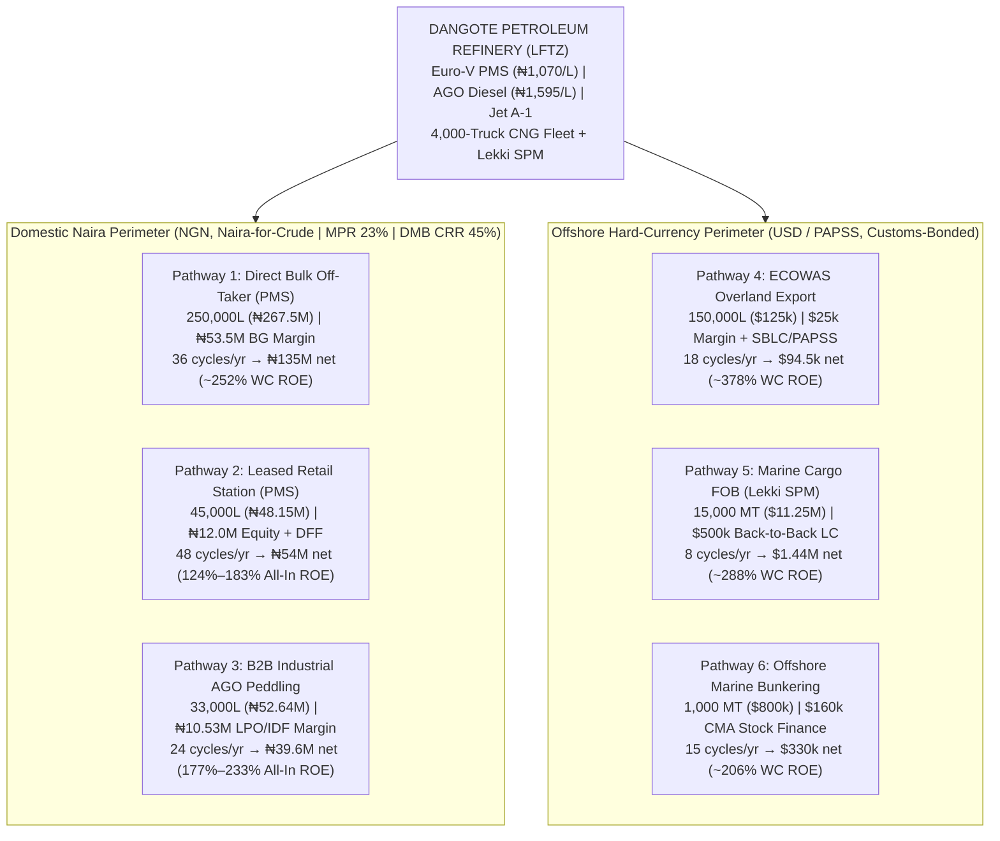
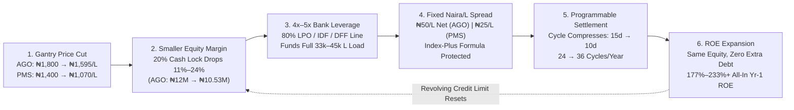
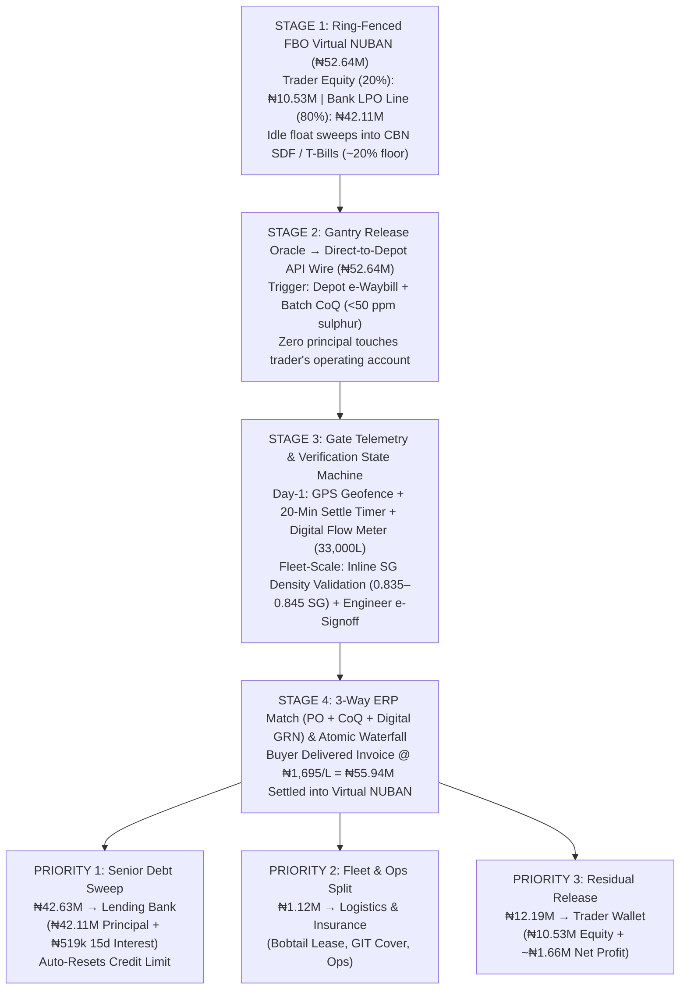

# The Velocity Engine: How Dangote’s Downstream Architecture Rewires Trade Finance, Credit Arbitrage, and Programmable Settlement

*Positioning Strategically for Macro Trends Affecting Fintech Products*

---

In an earlier edition of *The Yield Stack*, we examined why trying to build mega-infrastructure on commercial bank escrow terms can bleed a balance sheet dry through **escrow drag**: paying double-digit interest on undisbursed capital while 45% Cash Reserve Requirements (CRR) sterilize commercial bank deposits.

This week, we flip to the other side of the refinery gate.

Yesterday (November 26, 2026), the Dangote Petroleum Refinery slashed its Automotive Gas Oil (AGO/Diesel) gantry price by ₦125 to **₦1,595/litre**, just days after cutting Premium Motor Spirit (PMS/Petrol) ex-depot prices to **₦1,070/litre**. Most commentators read lower gantry prices as simple consumer relief or tighter trader margins.

Through a trade-finance lens, the exact opposite happens.

When per-litre distribution spreads remain anchored in Naira while the underlying commodity price drops 11% to 24%, **the working-capital equity required to finance each truckload shrink, riving Return on Equity (ROE) higher on the exact same physical volume**.

For decades, West African downstream energy trade operated as an offshore dollar-drain. Importers raised foreign-currency Letters of Credit (LCs) through European correspondent banks to haul refined products from Amsterdam-Rotterdam-Antwerp (ARA) into Lagos, locking up liquidity for 45 to 60 days per cargo. The operational ramp-up of the $20 billion Dangote Refinery inside the Lekki Free Trade Zone (LFTZ) ()has shifted the downstream profit equation from speculative import arbitrage to **high-velocity working-capital turnover**.

Whether you are an institutional commodities trader lifting 15,000 Metric Tons (MT) at the Lekki Single Point Mooring (SPM) or a mid-market operator deploying ₦17M–₦22M into B2B industrial diesel supply, downstream oil trading is not an asset-heavy game. It is a leveraged financial engineering play where thin unit margins of 1.5% to 4% compound into **124% to 233%+ all-in Year-1 cash-on-cash ROE** (and **200% to 450%+ on revolving working capital**) through rapid capital velocity.

---

## 1. The Macro Shift: Naira-for-Crude, The 23% MPR Hold, and the Dual-Currency Perimeter

Because the Dangote Refinery sits inside the Lekki Free Trade Zone, it operates legally offshore for customs purposes while physically anchoring Nigeria’s domestic energy grid. This creates a bifurcated dual-currency settlement architecture:

1. **The Domestic Naira Perimeter (NGN):** Under the Federal Government’s Naira-for-Crude framework, domestic consumption is priced and settled in Nigerian Nair, ith late-November 2026 gantry benchmarks at **₦1,070/litre for PMS** and **₦1,595/litre for AGO**. Direct PMS lifting is consolidated through approved consortium marketers (including MRS, NIPCO, Matrix, Bovas, Rainoil, and AA Rano) and registered trade associations (IPMAN, PETROAN, MEMAN), while direct gantry and coastal lifting remain open for AGO and Jet A-1. The refinery has also tightened channel discipline by prioritizing exclusive domestic off-takers over marketers actively importing blended off-spec petrol.
2. **The Offshore Hard-Currency Perimeter (USD):** Unauthorized overland trucking of Naira-priced fuel across Nigerian borders is strictly policed by the Nigerian Customs Service (Operation Whirlwind). All legal regional ECOWAS road exports and international marine liftings from the Lekki SPM are settled exclusively in US Dollars via irrevocable Letters of Credit (LCs), Standby Letters of Credit (SBLCs), or Afreximbank’s Pan-African Payment and Settlement System (PAPSS).

**The Monetary Policy Backdrop (Post-Nov 23–24 MPC):**
At its **308th Monetary Policy Committee (MPC) meeting on November 23–24, 2026**, the Central Bank of Nigeria (CBN) **retained** its eased policy posture following the earlier 350 bps cut:
- **Monetary Policy Rate (MPR):** Held at **23.00%** (as headline inflation moderated to ~14.06% in October 2026).
- **Standing Facilities Corridor:** Held at **+50 / -300 bps** (putting the Standing Deposit Facility floor at **20.00%**).
- **Cash Reserve Requirement (CRR):** Retained at **45.0%** for Deposit Money Banks (commercial banks), **16.0%** for Merchant Banks, and **75.0%** for non-TSA public sector deposits.

Because commercial banks still face a 45% CRR sterilization drag, they remain highly selective on unsecured corporate lending. Consequently, credit desks aggressively favor **self-liquidating, collateralized trade instruments**: Bank Guarantees (BGs), Distributor Finance Facilities (DFFs), Local Purchase Order (LPO) financing, and Invoice Discounting Facilities (IDFs).

To visualize how the Dangote Refinery's dual-currency perimeter splits domestic Naira trade from customs-bonded USD exports across all six financed commercial pathways, **Figure 1** maps the complete downstream settlement stack:

*Figure 1: Dangote Dual-Currency Settlement Perimeter & 6 Financed Commercial Pathways | editable draw.io file: [`diagrams/fig1_dual_currency_capital_stack.drawio`](./diagrams/fig1_dual_currency_capital_stack.drawio)*

---

## 2. The 6 Commercial Pathways & The Mathematics of Capital Velocity

Very few profitable downstream operators deploy 100% cash equity to purchase fuel. Instead, cash serves as a **15% to 25% equity margin** to unlock 3x to 5x bank credit lines, distributor overdrafts, or back-to-back documentary LCs.

Below is the recalculated master economic model across all six domestic and export pathways at **late-November 2026 gantry benchmarks (₦1,070/L PMS; ₦1,595/L AGO)**, incorporating ~28%–30% p.a. NGN commercial financing costs (~2.4% per 30-day cycle) and 0.5%–1.5% USD LC confirmation fees:

| Pathway | Min. Volume / Cycle | Single Cycle Value | Working-Capital Equity (20%–25%) | Primary Finance Instrument | Cycles / Year | Annual Gross Turnover | Net Profit / Cycle (After Interest & Opex) | Annual Net Profit (Working-Capital ROE) |
| :--- | :--- | :--- | :--- | :--- | :--- | :--- | :--- | :--- |
| **1. Domestic Direct Bulk Off-Taker (PMS)** | **250,000 L** (~5–7 trucks) | **₦267.50M** | **₦53.50M** (20% BG Margin) | 10–14 Day Dangote BG Credit Line | **36 cycles** (Every 10 days) | **₦9.63 Billion** (9.0M L) | **₦3.75M** (~₦15/L net) | **₦135.0M** (~252% WC ROE) |
| **2. Domestic Retail Station (PMS)** | **45,000 L** (1 Tanker) | **₦48.15M** | **₦12.00M** (~25% Revolving Equity) | Dealer Overdraft / Consortium DFF | **48 cycles** (Weekly refill) | **₦2.31 Billion** (2.16M L) | **₦1.125M** (~₦25/L net) | **₦54.0M** (~450% WC ROE; *124%–183% all-in*) |
| **3. Domestic B2B AGO Peddling (Diesel)** | **33,000 L** (1 Bobtail) | **₦52.64M** | **₦10.53M** (20% LPO Margin) | LPO Finance + Invoice Discounting | **24 cycles** (Every 15 days) | **₦1.26 Billion** (792k L) | **₦1.65M** (~₦50/L net) | **₦39.6M** (~376% WC ROE; *177%–233% all-in*) |
| **4. Export A: ECOWAS Overland** | **150,000 L** (~3–4 trucks) | **$125,000** | **$25,000** (20% Margin) | Confirmed SBLC / PAPSS Settlement | **18 cycles** (Every 20 days) | **$2.25 Million** (2.7M L) | **$5,250** (~$0.035/L net) | **$94,500** (~378% WC ROE) |
| **5. Export B: Marine Cargo (FOB)** | **15,000 MT** (MR Parcel) | **$11.25M** | **$500,000** (LC Fees & Margin) | Back-to-Back Irrevocable LC | **8 cycles** (Every 45 days) | **$90.00 Million** (120k MT) | **$180,000** (~$12/MT net) | **$1.44M** (~288% WC ROE) |
| **6. Export C: Offshore Bunkering** | **1,000 MT** (Barge Parcel) | **$800,000** | **$160,000** (20% Equity + Barge) | CMA Stock Finance / Broker Credit | **15 cycles** (Every 24 days) | **$12.00 Million** (15k MT) | **$22,000** (~$22/MT net) | **$330,000** (~206% WC ROE) |

> *Note on ROE Transparency:* "WC ROE" reflects return on revolving working-capital margin alone. For new entrants in Pathways 2 and 3, factoring in full upfront lease, licensing, and telemetry CapEx (Section 3) yields **124%–183% (Pathway 2)** and **177%–233% (Pathway 3)** all-in Year-1 cash-on-cash returns.

**Figure 2** illustrates the compounding mechanics behind this velocity engin, howing how yesterday's gantry price cuts shrink the required equity denominator while programmable settlement accelerates annual turns without adding debt:

*Figure 2: The Downstream Velocity Engine () editable draw.io file: [`diagrams/fig2_velocity_leverage_loop.drawio`](./diagrams/fig2_velocity_leverage_loop.drawio)*

### Inside the Unit Economics of the 6 Pathways

- : Direct Bulk / Gantry Off-Taker (250,000L Minimum):** Qualifying at Dangote’s **250,000-litre** bulk threshold unlocks complimentary CNG-truck delivery plus short-term (10-to-14-day) credit backed by a commercial Bank Guarantee (BG). Banks typically require a 20%–30% cash margin (often placed in yield-bearing Treasury Bills) plus a depot throughput lien. Liquidating wholesale on a cash-and-carry basis in 7–10 days at a ₦25–₦35/L gross spread leaves ~₦15/L net (**₦3.75M/cycle**) after BG utilization fees and depot levies.
- **Pathway 2 ()saving ₦30–₦80/litre (₦1.35M–₦3M per trip) normally lost to third-party bridging. Paired with a bank **Distributor Finance Facility (DFF)** that sweeps 85%–90% of daily POS collections, a semi-urban station dispensing 6,500L–7,500L/day turns a tanker weekly at ~**₦25/L net**.
- : B2B Industrial AGO Peddling (33,000L Load):** Fully deregulated and driven by fuel quality, corporate buyers pay a reliability premium for Dangote’s Euro-V diesel to protect high-value generators. An approved LPO unlocks 70%–80% pre-delivery LPO financing, while post-delivery **Invoice Discounting (IDF)** advances 80% within 24 hours of a signed Goods Received Note (GRN), compressing a 21-day corporate payment term into a 15-day cash cycle. At ₦1,595/L gantry and ~₦1,695/L delivered (₦100/L gross spread), deducting bobtail lease/fuel (~₦18/L), 15-day bank interest (~₦15.7/L on ₦42.11M financed), and insurance/ops (~₦16/L) leaves **~₦50/L net (₦1.65M/cycle)**.
- : Overland ECOWAS Tanker Export (150,000L Batch):** Supplying Benin, Togo, Ghana, Niger, or Mali requires International Off-Taker registration, an NMDPRA Export Permit, NEPC registration, and a commercial bank Form NXP for customs-bonded transit tankers. Settled via a confirmed pan-African SBLC or **Afreximbank’s PAPSS**, a 20-day door-to-door cycle nets **~$0.035/L ($5,250/cycle)**.
- **Pathway 5 ()netting **~$12/MT ($180,000/voyage)**.
- : Offshore Marine Bunkering (1,000 MT Parcel):** Licensed operators supply Marine Gas Oil (MGO/AGO) and Low-Sulphur Fuel Oil (LSFO) to vessels along the Gulf of Guinea (Lagos, Lomé, Tema). Financed via a **Collateral Management Agreement (CMA)** with inspectors like SGS or Vallis aboard a time-chartered double-hull barge, operators clear **~$22/MT net ($22,000/cycle)**.

---

## 3. Capital Efficiency Deep-Dive: The Asset-Light Launch Stack (Pathways 2 & 3)

For operators and corporate treasury desks targeting high Naira ROE without tying up ₦200M+ in land acquisition or brand-new tankers, **Pathway 2 (Leased Retail Station)** and **Pathway 3 (B2B AGO Peddling)** run on an **Asset-Light (Lease + Bank Leverage)** structure.

**Day-1 Bankability Rule:** Incorporate the operating vehicle with at least **₦10M–₦25M Authorized Share Capital**. Commercial credit committees routinely reject ₦100k–₦1M nominal share-capital entities requesting ₦40M–₦50M+ revolving trade lines.

| Cost Category | Pathway 2: Leased Retail Station | Pathway 3: B2B AGO Peddling | Regulatory / Operational Purpose |
| :--- | :--- | :--- | :--- |
| **1. Corporate & Tax Setup** | **₦450k – ₦850k** | **₦450k – ₦850k** | CAC (₦10M–₦25M share capital), FIRS TIN/TCC, EFCC SCUML certificate, domiciliation/legal retainer. |
| **2. NMDPRA Licensing & Unions** | **₦3.35M – ₦4.80M** | **₦850k – ₦1.65M** | **P2:** NMDPRA retail license/transfer, hydrostatic tank test & Fire Service, IPMAN/PETROAN zonal reg, pump calibration. **P3:** NMDPRA coastal/peddling permit, bobtail dip-chart calibration, NUPENG/PTD & haulage emblems, corporate vendor reg. |
| **3. Physical Assets, Leasing & Day-1 Telemetry** | **₦12.80M – ₦24.50M** | **₦4.20M – ₦7.50M** | **P2:** 1-yr lease on 4–6 pump peri-urban station, tank desludging/servicing, solar inverter + POS. **P3:** 3-month advance lease on metered bobtail truck, tamper-sealed digital flow meter + GPS telematics, calibrated portable glass hydrometer kit. |
| **4. Insurance & Bank Facility Perfection** | **₦850k – ₦1.50M** | **₦950k – ₦1.80M** | NAICOM Goods-in-Transit (GIT) & Fidelity cover, station all-risk liability (P2), 1% bank facility appraisal/perfection fee. |
| **5. Revolving Working-Capital Margin** | **₦12.00M** (~25% of ₦48.15M) | **₦10.53M** (20% of ₦52.64M) | Unlocks **₦36.15M** DFF/consortium credit (P2) or **₦42.11M** LPO/IDF line (P3) at Nov 2026 gantry prices. |
| **TOTAL CASH TO LAUNCH** | **₦29.45M – ₦43.65M** | **₦16.98M – ₦22.33M** | **Year-1 All-In Cash-on-Cash ROE:** **124%–183%** (P2) / **177%–233%** (P3). |

---

## 4. Commercial Execution: The B2B Diesel (AGO) Sales & Pricing Playbook

In Lagos, facility managers, hospital administrators, and factory procurement officers rarely switch diesel vendors over a ₦10/litre discount. They switch because incumbents expose them to two chronic operational leaks: **300–500 litre short-deliveries per load** (rigged dipsticks or aerated foam pumping) and **adulterated high-sulphur/condensate blends** that destroy ₦15M+ Cummins or Perkins generator injectors.

### A. Index-Linked Formula Pricing
Because gantry benchmarks move sharply (as demonstrated by yesterday’s ₦125/L diesel cut), quoting a fixed monthly price exposes your equity to sudden repricing. Institutional B2B operators contract strictly on an **Index-Plus Formula**:

$$\text{Delivered Price / Litre} = \text{Verified Daily Lagos Depot Benchmark} + \text{Fixed Logistics \& Credit Margin}$$

- : Residential Estates (COD / 48-Hour Settlement):** Lekki Phase 1, VI, Ikate, Ikeja GRA, Magodo. Pitch **Benchmark + ₦65–₦75/L** (~₦1,660–₦1,670/L today), clearing **~₦1.45M net** per 33,000L load with minimal bank interest.
- : Hospitals, Hotels & Data Centers (14-Day LPO Credit):** Pitch **Benchmark + ₦95–₦110/L** (~₦1,690–₦1,705/L), clearing **~₦1.65M net** after covering 15-day IDF financing (~₦519k).
- : Tier-1 Manufacturing & FMCGs (21–30 Day LPO Credit):** Ikeja, Ilupeju, Isolo, Ogba, Agbara. Pitch **Benchmark + ₦125–₦145/L** (~₦1,720–₦1,740/L), clearing **~₦1.85M net** after 30-day LPO financing.

### B. The 4-Step "Trojan Horse" Acquisition Protocol
1. **Geographic Cluster Density:** Concentrate inside one 10km radius (VI/Lekki/Ikate, Ikeja/Oregun/Magodo, or Ilupeju/Isolo/Amuwo-Odofin) so one 33,000L tanker can execute three 10,000L split drops in a single afternoon.
2. **The Gate Technical Audit:** Meet the **Chief Engineer or Facility Manager** with a calibrated glass hydrometer, thermometer, and sample jar. Offer a 2-minute live specific gravity (SG) check on their existing tank. Showing that incumbent fuel sits below **0.820 SG** (kerosene/condensate blend burning ~15% faster) or above **0.865 SG** (sludge/heavy blend) ()turns the engineer into an internal champion.
3. **The Split-Load Backup Trial:** Ask to onboard as a **Secondary/Backup Supplier** with a 5,000L–10,000L trial LPO governed by a **4-Point Gate-Delivery Protocol**: Batch Certificate of Quality (CoQ) attached, mandatory 20-minute settling period on level ground before dipping, dual verification (calibrated dipstick + tamper-sealed air-eliminator digital flow meter), and two signed 1-litre retained sample bottles.
4. **Tripartite Domiciliation:** Convert the trial into a bi-weekly SLA with a transparent contracted logistics/volume fee structure and an **Irrevocable Payment Domiciliation Letter** executed by the client’s CFO in favor of your lending ban, nlocking automated 80% LPO/IDF drawdowns every cycle.

---

## 5. The Programmable Trust Layer: Closing the Downstream Verification Blind Spot

Why do Nigerian banks still demand 20%–30% cash locks, Lagos/Abuja Certificates of Occupancy (C of O), and manual paper reconciliations before funding a 15-day self-liquidating diesel cycle?

Because traditional banking rails suffer from an **operational verification blind spot**. A credit officer in Victoria Island cannot natively verify whether a 33,000L bobtail truck actually lifted 0.840 SG Dangote AGO at the gantry, whether fuel was siphoned in transit, or whether a paper GRN presented for Invoice Discounting is genuine.

Wiring a programmable settlement layer (such as **Dependly**) into the trade cycle locks physical delivery milestones and Naira/USD clearing into a single deterministic workflow. **Figure 3** traces a live **33,000L B2B AGO delivery** at today’s **₦1,595/L gantry** (₦52.64M cost; ₦55.94M delivered at ₦1,695/L) from ring-fenced escrow funding through hardware gate verification to atomic priority waterfall settlement:

*Figure 3: Programmable Settlement Lifecycle & Priority Repayment Waterfall (33,000L B2B AGO @ ₦1,595/L) | editable draw.io file: [`diagrams/fig3_programmable_settlement_waterfall.drawio`](./diagrams/fig3_programmable_settlement_waterfall.drawio)*

### Why This Changes the Risk & Velocity Curve
- **Near-Zero Diversion Risk (Compressed LGD):** Because loan principal wires straight from a ring-fenced FBO virtual NUBAN to the depot ()collateral diversion drops near zero. (Buyer credit/insolvency risk remains underwritten by the lender, but operational fraud and cash-diversion LGD collapse.)
- **From Paper Audits to Sub-Minute IDF:** Bidirectional ERP integration (SAP, NetSuite, Dynamics) automates 3-way matching across PO + CoQ + digital GRN, compressing a 3–5 day manual bank verification delay into seconds.
- **Compressing Time = Expanding ROE:** At ~30% annual borrowing costs (~0.082% per day), every 4 days wasted waiting on paper waybills and manual compliance reviews burns ~₦140,000–₦200,000 in pure margin per truckload. Compressing a 15-day cycle down to 10 days pushes the exact same ₦10.53M equity pool from **24 cycles/year to 36 cycles/year** without adding a single Naira of new debt.
- **Treasury Sweep on Idle Float:** While tranches await scheduled lifting windows, ALCO treasury sweeps park uncalled escrow balances in short-term T-Bills or CBN Standing Deposit windows (~20% SDF floor), directly offsetting trade-finance carry.

---

## Actionable Takeaways

- **For Downstream Operators & Energy Entrepreneurs:** Lower gantry prices are a *gift* to leveraged operator, our required working-capital equity just fell by 11%–24% while per-litre spreads hold. Incorporate at ₦10M–₦25M share capital, go asset-light, and win B2B accounts at the gate with hydrometer transparency rather than price wars.
- **For Corporate CFOs, Estates & Industrial Plants:** Lock in Index-Plus formula contracts so gantry cuts flow through automatically, enforce the 4-Point Gate-Delivery Protocol, and route vendor settlements through milestone-verified escrow ledgers to eliminate phantom fuel burn.
- **For Commercial Banks, Merchant Banks & Private Credit Desks:** With MPR held at 23.0% and passive treasury yields stabilizing, active self-liquidating trade origination must scale. Embedding ring-fenced FBO escrow, delivery telemetry, and automated priority repayment waterfalls lets credit committees relax rigid real-estate (C of O) hurdles while scaling high-velocity downstream energy lending.

---

## Glossary of Terms

| Term / Acronym | Full Meaning & Context |
| :--- | :--- |
| **AGO / PMS / ATK** | Automotive Gas Oil (Diesel) / Premium Motor Spirit (Petrol) / Aviation Turbine Kerosene (Jet A-1). |
| **BG / SBLC / LC** | Bank Guarantee / Standby Letter of Credit / Documentary Letter of Credit. |
| **CMA: third-party surveyor (e.g., SGS, Vallis) controls physical inventory for a lender. |
| **CRR / MPR / SDF** | Cash Reserve Requirement (45% DMB, 16% Merchant) / Monetary Policy Rate (23.0%) / Standing Deposit Facility (20.0% floor). |
| **DFF / LPO / IDF** | Distributor Finance Facility / Local Purchase Order Financing / Invoice Discounting Facility. |
| **FBO / Virtual NUBAN** | "For Benefit Of" ring-fenced custodial account / transaction-specific Nigerian Uniform Bank Account Number. |
| **LGD: percentage of credit exposure lost if a counterparty defaults. |
| **NMDPRA / CELPS** | Nigerian Midstream and Downstream Petroleum Regulatory Authority / Centralized Licensing Portal. |
| **PAPSS** | Pan-African Payment and Settlement System (backed by Afreximbank) for cross-border local-currency clearing. |
| **SG (Specific Gravity)** | Fuel density ratio; Dangote Euro-V diesel sits in the **0.835–0.845 SG** range. |

---

## LinkedIn Distribution Pack (Ready to Post)

### Suggested LinkedIn Post Hook
> Yesterday, Dangote slashed diesel gantry prices by ₦125 to **₦1,595/L**: days after petrol dropped to **₦1,070/L**.
>
> Most people see lower fuel prices and assume traders make less money.
>
> In leveraged trade finance, the exact opposite happens.
>
> Because downstream logistics and credit spreads stay anchored in Naira per litre, an 11%–24% drop in gantry prices shrinks the working-capital equity needed to finance every truckloa, ushing Return on Equity **higher** on the exact same physical volume.
>
> In our earlier *Yield Stack* edition, we broke down how commercial bank escrow drag can bleed a mega-project dry. In today's sequel, **The Velocity Engine**, I break down the other side of the refinery gate:
> - The 6 financed commercial pathways (from ₦10.5M B2B diesel LPOs to $11.25M marine FOB cargoes) recalculated at **today's** Nov 2026 gantry prices
> - Why the CBN holding MPR at 23% (and DMB CRR at 45%) pushes banks toward self-liquidating trade instruments
> - How programmable escrow, hardware delivery oracles, and priority repayment waterfalls replace C-of-O real estate collateral
>
> Full breakdown in this week's edition of *The Yield Stack* 👇

### 3 Thought-Provoking Discussion Questions
1. With Dangote cutting AGO to ₦1,595/L and PMS to ₦1,070/L, will commercial banks lower their 20%–30% cash collateral margins on LPO/IDF facilitie, r will verification blind spots keep credit locked behind Lagos/Abuja C of Os?
2. If you run a Lagos factory or estate burning 30,000L+ of diesel a month, how much of your annual power bill is actually *phantom burn* from unverified dipsticks and <0.820 SG blended fuel?
3. Should Nigerian banks treat a tamper-sealed flow meter + GPS geofence + priority FBO repayment waterfall as stronger collateral than a physical C of O that takes 5 years to foreclose in court?
